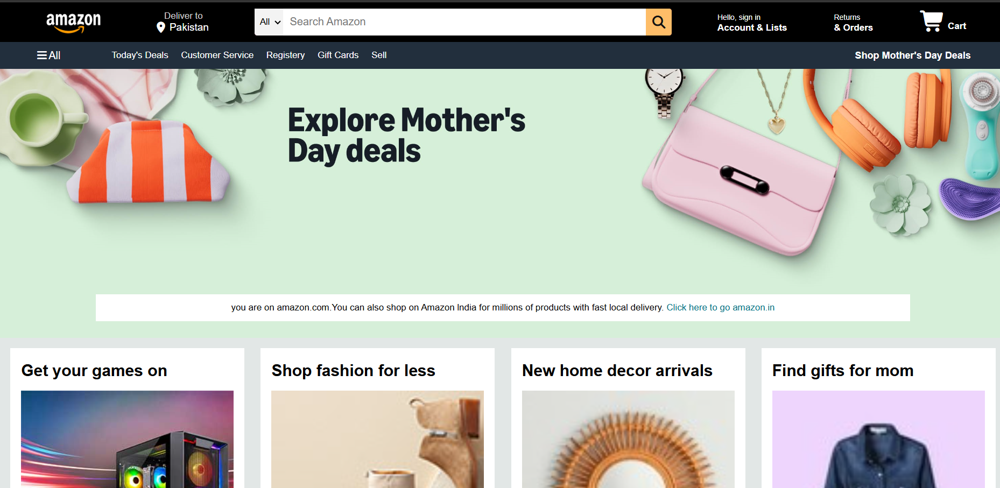
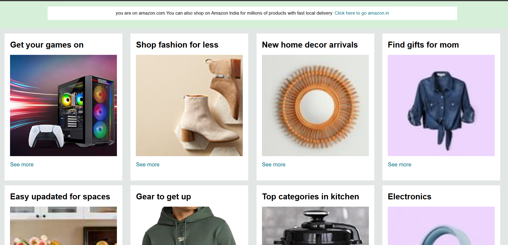
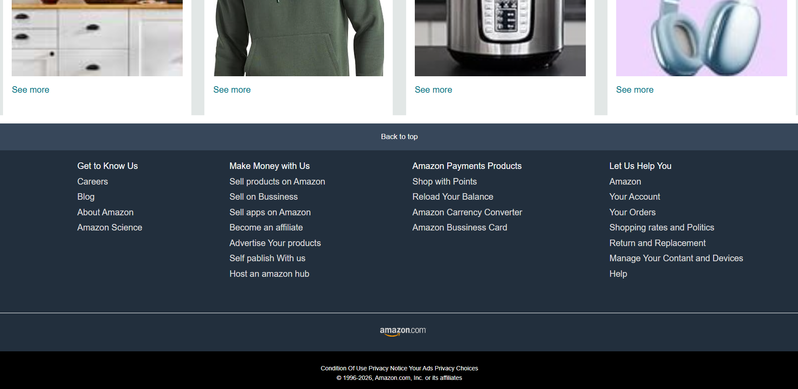

# 🛒 Amazon Clone --- HTML & CSS

A beginner-friendly Amazon-inspired homepage built with **HTML5 and
CSS3**. This project recreates key parts of an e-commerce homepage,
including a navigation bar, search area, shopping category cards, and
footer.

## 📸 Screenshots

### Home Page

### Categories

### Footer

## ✨ Features

-   Navigation bar with delivery location
-   Search bar with category selector
-   Account and orders sections
-   Shopping cart icon
-   Hero banner
-   Eight shopping category cards
-   Multi-column footer
-   Font Awesome icons
-   Amazon-inspired styling

## 🛠️ Built With

-   HTML5
-   CSS3
-   [Font Awesome](https://fontawesome.com/) icons

## 🎯 What I Practiced

-   HTML page structure
-   CSS styling and Flexbox layout
-   Navigation and search-bar layout
-   Shopping category cards
-   Page sections and footer design

## 👨‍💻 Author

**ABIHA NADEEM**

## 📌 Disclaimer

This is an educational frontend practice project inspired by Amazon's
homepage. It is not affiliated with, endorsed by, or officially
connected to Amazon.

------------------------------------------------------------------------

⭐ If you find this project useful, consider giving the repository a
star.

**Made with ❤️ using HTML & CSS**
